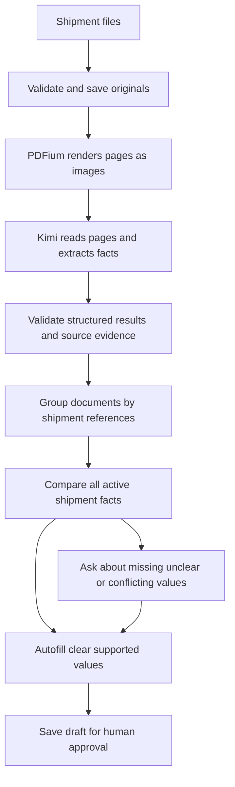

# How Kimi fills a shipment draft

Kimi is the only document extractor in the current pipeline. For a PDF, AICD makes images of the pages and asks Kimi to read them. It does not first read a hidden PDF text layer or run OCR. Application code checks the returned evidence, groups related documents, compares the shipment's facts and fills the editable declaration draft.

A clearly read, source-linked value does not need a separate confirmation merely because AI read it, or because it appears in only one appropriate document. Questions are for information that is missing, unclear, inconsistent, ambiguous or affected by changed sources. For example, a clear invoice number can fill automatically. Two different gross weights for the same shipment require a question. A packing-list package count and an invoice sales quantity describe different things and must not be treated as a disagreement.

This is inference using an existing model, not training or fine-tuning Kimi on your shipments. Automatically filling a draft is separate from a human approving or submitting it.

## Administrator setup

The owner sets `MOONSHOT_API_KEY` on the server. The default model is `kimi-k2.6`; `MOONSHOT_MODEL` is an optional administrator override and must support vision for PDFs and images. End users cannot change the provider or enter keys in Settings. Settings remains limited to Gmail and ECUS connections.

For the local installation:

1. Stop the local server before editing its configuration.
2. Open `.aicd-local/.dev.vars` in a local editor and preserve the generated entries.
3. Add `MOONSHOT_API_KEY=your_private_key`. Optionally set `MOONSHOT_MODEL=kimi-k2.6`.
4. Start `npm run local` and keep the browser open during extraction.

Keep the key in that private file or an administrator-managed server environment. It must not go in chat, a browser field, a `VITE_`/`NEXT_PUBLIC_` variable, source code or shell history. See [local setup](local-setup.md) for file permissions, environment precedence, disabling Kimi and backups; see [standalone setup](standalone-setup.md) for the retained deployment adapter.

The fixed provider endpoint is `https://api.moonshot.ai/v1/chat/completions`. Page images are sent as inline base64 image content, with JSON output requested. The default K2.6 request disables thinking mode and leaves sampling parameters at the provider defaults. See the [official Kimi K2.6 documentation](https://platform.kimi.ai/docs/guide/kimi-k2-6-quickstart). A configured status means configuration is present; it does not prove account balance, model access or live accuracy.

## What happens to a PDF

1. **The browser prepares the upload.** It identifies files and email attachments. The server counts physical PDF pages; PDFium later checks that count and renders the pages. PDF.js and Tesseract are no longer dependencies of the extraction pipeline, and there are no OCR workers or language assets in that pipeline.
2. **The original is saved privately.** The server validates the upload and computes its SHA-256 fingerprint. A fingerprint identifies the exact bytes of the file. Related files may arrive together or in later emails; a common sender or filename alone does not prove that they belong to one shipment.
3. **The browser prepares page images.** It downloads the authenticated original, checks its fingerprint, and uses PDFium to render selected physical pages as bounded JPEG images. Uploaded image documents use the same bounded image preparation path. Rendering means drawing an existing page; it does not recognize words or decide form values.
4. **The server calls Kimi.** It checks the workspace, document version, original fingerprint, page number, image format and size. It sends the private page images using the server's key. It never asks Kimi to fetch an arbitrary browser-supplied image URL. PDFs and images use the visual reading rather than old PDF.js/OCR text.
5. **Kimi reads and extracts.** The response identifies whether each page is clear or uncertain, its document type and the factual field proposals. It does not create a full transcript of every word; the text view shows the saved source quotations. Each value identifies its source page and quoted reading; visual values also identify a region of the page. Goods cells identify their physical row. The prompt forbids invented information and treats instructions printed in documents as source content rather than commands.
6. **Application code checks and combines the result.** It validates the JSON shape, allowed fields, page references, image evidence, quoted values and conservative normalization. It keeps commercial buyer/seller roles separate from transport agents. Shipment references decide document grouping; the settled shipment's combined facts supply the web draft.
7. **Clear facts fill automatically.** Clear, supported values without contradictory evidence do not create routine confirmation questions. An uncertain page or field, conflicting documents, ambiguous dates or incomplete required information still needs attention. Existing human corrections and their history remain protected; replacing their supporting evidence can reopen the affected question.
8. **The person approves the completed draft.** Kimi cannot approve a declaration, send email or submit to customs. Regulations and real ECUS integration remain separate future capabilities.

TXT, CSV and XML files use the same Kimi-led field extraction with their raw text instead of page images. Reading text bytes for the model is file preparation; it does not independently select values for the form. Other office formats currently need a PDF export before extraction. Unsupported files remain preserved and can be replaced with a readable representation.

## Why remove PDF.js and OCR?

The initial pipeline combined three readers, which created extra low-confidence states even when a value was visible. This version follows the requested simpler approach: Kimi reads the source, and ordinary code checks its structure and consistency. PDFium remains only because the vision API needs page images.

There is no automatic OCR fallback. If evaluation shows that Kimi repeatedly misreads particular layouts, a second reader can be added deliberately and tested against the same checked answers. Adding another reader before measuring the failure would create more complexity without establishing better accuracy.

Kimi can still read a digit incorrectly or assign a real value to the wrong field. An image region and an “uncertain/clear” label are evidence metadata, not an independent guarantee. To evaluate the tradeoff, compare results against broker-reviewed answers from representative suppliers, scans, languages, document types and known disagreements. Measure unflagged errors as well as the number of manual questions.

## Evidence, privacy and trust

Original documents, page image derivatives, Kimi page metadata and field candidates are separate records. The original fingerprint identifies the file; the document version identifies the current interpretation context; an image fingerprint identifies the rendered bytes used by the model. A later document replacement cannot silently reuse the earlier evidence.

These checks identify the uploaded derivative the system used. They do not cryptographically prove that the browser rendered the page truthfully, and the server does not independently render every PDF. The original document remains available beside the source evidence.

Kimi receives no tools for email sending, ECUS, shell access or database changes. The application accepts only bounded structured output and validates it before creating internal actions. Printed instructions cannot override the workflow. The general workspace endpoint cannot accept arbitrary caller-created AI extraction results.

With Kimi configured, page images and relevant text leave the Mac for Moonshot processing under the administrator's account. Source downloads exclude shipment files and keys. The implementation does not establish a new data-retention agreement with Moonshot or certify compliance with customs requirements.

## Waiting, interruption and historical data

Without a server key, originals are saved in a waiting-for-Kimi state. They are not passed through PDF.js, OCR or a deterministic fallback. The website asks for administrator configuration and retains the extraction action; users are not asked to transcribe every pending page manually. Optional manual correction remains available.

The browser processes pages in bounded batches and saves each successful response using the latest workspace revision. Completed-page progress is preserved if a later request fails, a rate limit is reached or the browser is closed. The extraction action can resume unfinished pages. There is no durable background worker continuing browser rendering after the tab closes.

Provider calls have page, text, image-size, output and per-minute limits. Larger documents can need more than one attempt. A timeout may occur after billable work has begun, so failed calls are not blindly retried. A revision conflict requires reloading current state before continuing.

Historical sample records and existing human decisions remain preserved. This code update does not silently reprocess all samples or relabel old OCR/parsing results as Kimi output. New Kimi processing stores its own provenance. No live key was available during implementation, so provider checks use controlled responses rather than claiming a measured improvement on the supplied samples.

## Where the code lives

| File | Responsibility |
| --- | --- |
| [client-intake.ts](../lib/client-intake.ts), [pdf-pages.ts](../lib/pdf-pages.ts) | Prepare files and attachments; count physical PDF pages without text extraction or OCR. |
| [client-vision.ts](../lib/client-vision.ts) | Verify authenticated originals, upload bounded page images and run resumable Kimi batches. |
| [client-pdf-raster.ts](../lib/client-pdf-raster.ts), [pdf-raster.ts](../lib/pdf-raster.ts), [pdf-raster-worker.ts](../lib/pdf-raster-worker.ts) | Render PDFium page pixels in a cancelable worker with a timeout; no text extraction. |
| [vision.ts](../lib/vision.ts), [server-vision.ts](../lib/server-vision.ts) | Validate image sizes and source binding; protect private derivative storage. |
| [server-kimi.ts](../lib/server-kimi.ts), [intake-ai.ts](../lib/intake-ai.ts) | Authorize Kimi extraction and apply request, source-version and revision limits. |
| [kimi.ts](../lib/kimi.ts) | Build the provider request and validate page readings and source-backed facts. |
| [engine.ts](../lib/engine.ts), [shipment-grouping.ts](../lib/shipment-grouping.ts) | Apply results, group related documents and generate unresolved issues. |
| [shipment-autofill.ts](../lib/shipment-autofill.ts) | Combine shipment evidence into supported editable declaration fields. |
| [local-config.mjs](../scripts/local-config.mjs), [local.mjs](../scripts/local.mjs) | Load administrator secrets and run the isolated local workspace. |

The pipeline does not yet implement live Gmail synchronization, background follow-ups, a verified complete mapping to ECUS5-VNACCS 2018 build 6.0.248, regulation checks or a real ECUS connection. The current result is a source-linked draft saved in the web application.
